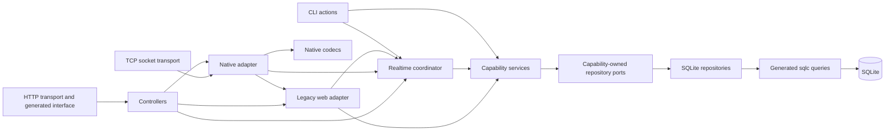

# Go compatibility backend and historical service pages

The backend serves the recovered **mig33 Java ME 4.62** packet protocol over both TCP and HTTP. It also keeps the historical `/sites/index.php?c=...&a=...&v=midlet` page paths. Direct messages, public rooms and private group conversations share persistent accounts with local implementations behind all52 retained page templates. SQLite also stores profiles/preferences, community Groups/forums, credits/store inventory, social posts, local mail, photos and provider requests. The five documented development accounts are initial seeds; native and web registration create additional persistent accounts. This is not a connection to the historical service or its account database. See the [chat guide](chat.md) for delivery/history and the [room guide](rooms.md) for browsing, membership and moderation.

The agreed backend milestone uses recovered behavior where established and explicit local replacements or reference placeholders elsewhere. SMS, external email, calls and payments remain mocked: requests and test-credit receipts persist without contacting providers. External IM remains a disconnected saved-contact adapter pending a later decision. Expo and its Classic v3 UI mode are deferred frontend work, outside this backend milestone.

## Composition, routing and persistence

The backend is a capability-oriented modular monolith: one Go module, one SQLite database and one realtime coordinator per process graph. The [complete migration research](../research/architecture/go-hexagonal-migration.md) is implemented. The old `internal/services`, `internal/domain` and aggregate repository/service ports have been removed. Full race tests, vet, architecture guards, generator/schema checks and all 17 original-client suites pass; the [implementation record](../research/architecture/evidence/go-capability-implementation.json) retains the results and exact source/binary provenance.

Each executable owns its flags, transport selection and process policy. `cmd/internal/command` handles configuration flags and process plumbing. [Core wiring](../cmd/internal/wiring/core.go) opens SQLite with the startup context, constructs capability services with their explicit collaborators, initializes the realtime coordinator, and returns a concrete `Graph` plus cleanup. The graph exposes objects for entrypoints to select; it has no application forwarding methods. Failed startup releases acquired resources, and normal cleanup closes the coordinator and repository once after workers and transports stop.

`cmd/http` selects HTTP, `cmd/socket` selects TCP and `cmd/omni` selects both around the same graph. [Bootstrap](../internal/bootstrap/runtime.go) receives arbitrary `Component{Name, Start, Run, Stop}` hooks. It establishes readiness in order, supervises workers, rolls back partial startup, stops components in reverse order with a separate shutdown budget, and joins failures. It imports no application, configuration or transport package. Application maintenance starts through `Coordinator.Run(ctx)`, never a constructor.

Two processes sharing a database still have separate sessions, occupancy, votes and delivery queues. `cmd/cli` calls typed report administration and room moderation operations with its command context; it starts neither listeners nor maintenance.

The diagram shows runtime calls; SQLite implements the capability-owned persistence contracts:



[Controllers](../internal/controllers/controller.go) remain one package with feature files and directly implement the generated `httpapi.ServerInterface`. They consume [small explicit behavior contracts](../internal/controllers/dependencies.go), decode generated parameters, manage cookies and map results into HTTP responses. They receive no repository. HTTP JSON chat operations use typed inputs/results directly; they do not construct binary packets.

| Package | Owned behavior and models |
| --- | --- |
| `accounts` | Credentials, registration/recovery, profiles/preferences, privacy and customization |
| `contacts` | Address-book contacts/groups, validation, idempotent additions and personal blocking persistence |
| `chat` | Direct/private-group messages, membership, history, read cursors and pure slash-action policy |
| `rooms` | Public room definitions, permissions, browsing/management, moderation rules and vote thresholds |
| `community` | Community Groups, membership, forums and links to public rooms |
| `commerce` | Test-credit ledger, gifts, inventory, themes and purchase effects |
| `catalog` | Static product/game/emoticon metadata and entitlement policy |
| `media` | Photos, avatar changes and visibility |
| `review` | Abuse reports, support review and trusted operator decisions |
| `activity` | Social entries, inbox/provider requests and local game records |

Each capability owns its types and the interfaces it consumes. Business packages have no protocol, HTTP, templ/page, generated SQL, concrete database, configuration or bootstrap imports. Shared error identities live in `faults`; immutable session views live in `session`. There is no database transaction object in a business API. The [SQLite adapter](../internal/adapters/sqlite/repositories/ports.go) implements nine capability repository contracts, while other small consumer interfaces describe actual cross-capability reads. Adding a database requires its own queries, migrations, mappings and conformance tests plus a wiring change.

The package dependency direction differs from the runtime call direction above. Composition imports the concrete graph; adapters import the business contracts they implement or consume. Business packages never import their adapters:

```text
cmd/* -> cmd/internal/{command,wiring}, bootstrap, selected transport
cmd/internal/wiring -> capability services, realtime, concrete adapters
controllers -> generated httpapi, capability/session types, consumer contracts
adapters/native -> commands, events, nativecodec, legacyweb, native Application contract
adapters/nativecodec -> protocol, commands, events, capability types
adapters/legacyweb -> capability/session types, pages, consumer contracts
realtime -> capability services, commands, events, session, faults
capabilities -> owned repository contracts, required capability types, faults
adapters/sqlite/repositories -> capability contracts/types, generated sqlc
bootstrap -> standard library only
```

Some capability contracts deliberately use another capability's types: community room links use `rooms.Room`, and report review uses `activity.ServiceEntry`. These are explicit acyclic dependencies, not a replacement shared model package. [Import guards](../internal/ports/boundaries_test.go) check the boundary as packages evolve.

The [realtime coordinator](../internal/realtime/application.go) owns sessions, cached identities, presence, live participants, ballots, queue admission and ordered delivery. It calls capability services and applies committed effects under the relevant workflow boundary. For example, account changes update cached credentials and invalidate sessions; personal blocking persists before queued deliveries are canceled. Shared state is not copied into independently locked capability services. Response gates, account delivery gates and the state mutex retain their established acquisition order.

The [native adapter](../internal/adapters/native/adapter.go) consumes a typed application interface. [Native codecs](../internal/adapters/nativecodec/codec.go) translate packet tags/opcodes into `commands.Request` values and encode `events.Event` payloads. Optional fields retain separate presence and validity flags, preserving absent-versus-malformed validation. Codecs also own the original bundled protocol resources. Only this adapter associates encoded packet pointers with typed events; business state uses an opaque `events.Handle` for each delivery reservation. Message IDs alone cannot distinguish recipients, sessions and repeated attempts.

Native transports call `Poll(ctx, sessionID, limit)` while holding the session response gate. Poll returns a bounded batch; transports do not receive or drain the coordinator's mutable queue directly. Eligibility is checked before writing, and `FinishWrite` reports success or failure for the exact reserved events. Unwritten or canceled deliveries release their reservations so the same session can retry. Delivery acknowledgments follow a successful write/flush; this does not promise exactly-once network delivery.

Each transport retains its encoded-frame associations until write completion. Closing a shared session changes delivery eligibility without discarding another transport's acknowledgment for an already committed command. Queued chat remains ineligible after session revocation, and an interrupted socket batch releases all unwritten reservations.

The [legacy web adapter](../internal/adapters/legacyweb/contracts.go) owns historical query selectors, forms, URL handling and rendered responses. Its [page registry](../internal/adapters/legacyweb/page_routes.go) serves both HTTP and native `922/923` through typed capability calls and explicit realtime workflow methods. Reusable templ components and legacy markup serialization remain in `internal/pages`. All 52 historical templates retain their original selector URLs. The WAP composer, registration, profile pages, operator pages and media endpoints use this same graph.

The [OpenAPI contract](../api/openapi.yaml) describes 23 HTTP paths and 28 operations. Nine JSON/health operations generate routing and transport types through pinned `oapi-codegen`. [HTTP composition](../internal/adapters/httptransport/router.go) mounts them alongside the binary gateway, WAP, operator, media and historical page routes. `/sites/index.php` remains one path per method with selectors documented under `x-legacy-routes`; TCP operations remain in the [protocol reference](../research/applets/v3/docs/protocol.md).

All 124 repository operations take `context.Context` first. HTTP passes request contexts; socket and CLI operations use their owning contexts. Constructors only assemble dependencies. Startup I/O runs under `Initialize(ctx)`, and repository calls pass the same operation context into generated queries and `BeginTx`. Error wrappers retain underlying causes for `errors.Is` and `errors.As`. Request cancellation is checked again after state-lock admission; it cannot forcibly interrupt arbitrary Go code or all driver lock/commit waits. Cleanup and write completion have explicit bounded lifetimes owned by transports.

Atomic workflows remain inside the SQLite adapter using one generated sqlc `DBTX` package:

- Registration consumes the challenge and creates the identity, roster and Friends group in one transaction.
- Message acceptance commits durable authorization checks, the message, immutable audience and optional request-key/hash receipt together. Live room membership remains coordinated by realtime.
- A gift purchase commits its replay receipt, debit/ledger, inventory, note and durable gift message/audience together. Delivery wakeups cannot decide whether the purchase occurred.

These are specialized atomic workflow contracts, rather than independent repository commits joined by an in-memory event bus. There is no generic transaction in context or domain-visible `*sql.Tx`. A returned committed identity or receipt is applied without a new cancellable read being required to establish success. Canonical `chat.MessageInput` JSON field order and native retry nonce construction retain persisted replay semantics.

Runtime SQL remains in [named queries](../db/queries/messages.sql), generated by sqlc 1.31.1 under `internal/adapters/sqlite/sqlc`. The 218 queries and migrations [001.sql](../db/migrations/001.sql) through [018.sql](../db/migrations/018.sql) retain their existing roles. The [transactional migration runner](../internal/adapters/sqlite/migrations/migrate.go) uses the embedded numbered files, including sequence repair support. Schema export and migration tests compare the generated snapshot with a real upgrade.

[Architecture guards](../internal/ports/boundaries_test.go) enforce capability dependencies, operation contexts, removal of obsolete aggregates and generated-only feature SQL. The [test migration inventory](../research/architecture/evidence/capability-test-migration.json) maps all 179 original service test names to current regression tests and records the hash of the retained [pre-removal source archive](../research/architecture/evidence/capability-before-source.tar.gz). [Repository-boundary tests](../internal/realtime/repository_ports_test.go), native codec tests and adapter/acceptance suites exercise authorization, immutable audiences, session ordering, cancellation and historical presentation separately.

```sh
scripts/generate-openapi.sh
scripts/generate-sqlc.sh
python3 scripts/export-sqlc-schema.py --check
go test -race ./...
go vet ./...
python3 tools/applets/scripts/validate_reference.py
```

Generators are pinned and generated Go files are checked in. [Configuration](../configs/README.md) still applies embedded defaults, on-disk `app.yaml`, environment overlays, extra overlays, `MIG33_*` variables and explicit command-line overrides. Provider mocks and account seeds retain their existing behavior. The earlier [seven-suite lifecycle acceptance](../research/acceptance/v4/lifecycle-result.md) remains a prior baseline. The current [implementation evidence](../research/architecture/evidence/go-capability-implementation.json) records all 17 passing suites, 48 original-client scenarios and clean integrity checks for every isolated database. It also retains failed attempts and explains the isolated fixture-name and presence-helper corrections; the publisher JAR is unchanged.

## Run

From the repository root, with Go 1.27.3 or newer and a C compiler (Clang on macOS or GCC on Linux). Go 1.27.3 is the [latest stable release verified on 2026-10-29](https://go.dev/dl/); `go.mod` records this minimum, and automatic toolchain selection can download it when needed. The [SQLite driver](https://github.com/mattn/go-sqlite3) requires CGO; the build uses the pinned version in `go.mod`:

```sh
go run ./cmd/omni
```

The defaults are TCP `127.0.0.1:9119`, HTTP `http://127.0.0.1:8080`, and that same HTTP origin advertised in the login response. Chat data is stored in `data/chat.sqlite`; choose another path with `-db PATH`, or temporary state with `-db :memory:`. If the sandbox blocks Go cache writes, prefix commands with `GOCACHE=/tmp/mig33-go-build GOMODCACHE=/tmp/mig33-go-mod GOPATH=/tmp/mig33-go`.

| Test username | Password |
| --- | --- |
| `alice` | `alice-demo` |
| `bob` | `bob-demo` |
| `carol` | `carol-demo` |
| `dave` | `dave-demo` |
| `hailam` | `hailam` |

The four original demo accounts receive starter contacts once; `hailam` starts with an empty Friends group. Contact lists and groups are now saved and editable; see [contact management](contacts.md). Private and group text can be sent to offline members; it remains queued in the database until transport delivery. Restarting preserves messages, pending deliveries and group membership. Accounts, password changes, profiles, status and preferences also survive restart. Sessions and presence remain temporary, so clients must log in again after a restart. Registration and activation use development code123456; see [identity and account pages](identity.md).

Public rooms are **Lobby**, **Gaming** and **Help**, with50 unique users allowed in each. Room participation belongs to the joined session; room traffic does not replay as offline chat. New rooms default to50, and owners can set capacity from2 to100 without reducing it below current occupancy. Room Settings also stores language, keywords, description, ownership, moderator roles, bans and the ordinary-user kick-vote toggle, with a change audit. Alice is the initial local moderator in all three rooms. The [operator command](rooms.md#moderator-roles) can change those roles.

For a handset or emulator on another machine, explicitly choose reachable listen addresses and an advertised origin:

```sh
go run ./cmd/omni \
  -http 0.0.0.0:8080 \
  -tcp 0.0.0.0:9119 \
  -public-url http://YOUR-LAN-IP:8080
```

The default loopback bindings, seed credentials and static OTP are intended for development. Accounts store salted PBKDF2 password verifiers plus a separate Java-hash/UTF-16-length compatibility verifier for the original202 challenge; passwords are not stored as plaintext. The legacy verifier remains weak and password equivalent. Production verification, abuse controls and the future frontend authentication boundary remain separate work; see [the identity contract](identity.md).

The [target and gap audit](target-and-gaps.md) records this local v4 backend scope, its mocked services and the separate frontend and historical-recovery work.

## Client connection and URLs

The original client supports saved host/port and HTTP/TCP preferences. Set the gateway host to the development server, TCP port to `9119`, or the HTTP host to `127.0.0.1:8080`. Its default still names `gateway.mig33.com`; merely starting this server does not redirect an unconfigured client. The controlled integration harness uses only local connections.

The `203` response supplies the replacement website and asset bases. Feature URL paths, controller/action selectors and query parameter names remain unchanged. No `.php` file or PHP interpreter is needed: a Go handler dispatches the literal `/sites/index.php` path. A local DNS override can preserve legacy hostnames inside a test environment; this project does not control the public `mig33.com` domains. The controlled Connector bridge narrowly rewrites the original username-check and language-catalog URLs to local services. Test ports can be selected explicitly; all connections remain loopback. Public DNS and other external provider URLs are unchanged.

| Interface | Implemented behavior |
| --- | --- |
| TCP `:9119` | Concatenated/fragmented original binary frames, correlated replies, asynchronous pushes |
| HTTP `POST /` | Initial login200, registration101/103, help7, local recovery guidance904 and connection test2 |
| HTTP `POST /{session}` | Binary requests after the challenge; `sid` header is also accepted |
| HTTP `GET /{session}` | Drain pending messages/presence; empty queue returns HTTP 200 with an empty body |
| `/sites/index.php?c=profile&a=home&v=midlet&username=bob` | Authenticated reconstructed profile page; absent username selects self |
| `/sites/index.php?c=profile&a=edit&v=midlet&field=customization` | Authenticated profile formatting editor; CSRF-protected save/reset, owned photo references and profile privacy checks |
| `/sites/index.php?c=profile&a=search&v=midlet` | Authenticated GET/POST local friend directory, profile links, native Chat and Add Friend |
| `/member2/t.php` | Formatted WAP chat for private, group and room conversations; browser account sign-in or existing native session; [form and delivery contract](text-and-page-formatting.md#implemented-formatted-wap-chat) |
| `/sites/index.php?c=help&a=main&v=midlet` | Authenticated help for supported local features |
| `/sites/index.php?c=settings&a=block_list&v=midlet` | Authenticated personal block list; protected POST form unblocks users |
| `/sites/index.php?c=report&a=report_abuse&v=midlet&type=4&subject=Chatroom&subject_id=Lobby` | Authenticated GET form and protected POST; persists a room report. `subject=Group%20Chat` selects a private group. [Form contract and CLI review](reports.md) |
| `/sites/index.php?c=chatroom&a=search&v=midlet` | Authenticated search form/results with original native room-join links |
| `/sites/index.php?c=chatroom&a=create&v=midlet` | Authenticated two-step POST creation; persists room and creator moderator role |
| `/sites/index.php?c=chatroom&a=setup&v=midlet&roomName=Lobby` | Room Info and authorized management forms; no automatic join. `manage=1` opens owner/moderator settings, bans and change audit |
| Other catalogued feature pages | All52 retained templates dispatch to local service handlers: account/settings, Groups/forums, store, social/media, games, mail and provider-request pages. See [service contracts](service-pages.md) and [community/commerce](community-commerce.md) |
| Public registration/recovery | `c=registration&a=home`, `c=registration_api&a=check_username`, and `c=account&a=recover`, all `v=midlet`; no sid required |
| `POST /api/photos` | New authenticated PNG/JPEG upload extension; requires CSRF and an idempotency key |
| `GET /assets/photos/{id}` | Authenticated, authorized photo bytes |
| Unknown pages / wrong methods | HTTP 404 / 405 |
| `GET /healthz` | Process health and `local-demo` mode |
| `GET /api/catalog` | Public static products, emoticons, game availability, languages, original-default theme and mock-provider modes; no account data or mutations |
| `GET /api/chat/history?kind=private&target=bob` | New authenticated history extension; not a recovered historical URL |
| `GET /api/chat/groups` | New authenticated membership extension; not a recovered historical URL |
| `GET /api/chat/session`, `GET /api/chat/sync` | Session CSRF token and paginated private/group transcript synchronization; see [chat contract](chat.md) |
| `POST /api/chat/messages`, `POST /api/chat/read` | Persistent send idempotency and account-private read positions; authenticated JSON with CSRF |
| `GET /api/contacts` | Complete authoritative roster for a recreated frontend, including phone/IM identities and contact groups |
| `/operator` | Reports/support/category dashboard; disabled unless startup `-operators` names authorized accounts; [operator guide](operator-review.md) |
| `/sites/resources/language/v4.6/l`, `/sites/resources/language/v4.6/en-US` | Public binary1002 catalog and byte-exact recovered English1004 language pack |

Direct page requests require the authenticated `sid` header sent by the original client or a signed-in WAP browser session, except the three explicitly public registration/recovery routes. `/member2/t.php` also provides browser sign-in with an existing account. Packet `922` requests dispatch to the same page handlers and return `923` with status/body/cache fields. They never fetch arbitrary external URLs; absolute URLs must match the configured origin. The historical tunnel uses `Content-Type: image/gif` despite carrying binary packets. An HTTP 200 can still contain an opcode `0` application error.

The service HTML uses typed templ components and shared document, text, link, form and control templates. A single renderer boundary adapts URL-attribute ampersands and void-element syntax for the original embedded browser; business handlers do not concatenate HTML. Profile customization and WAP chat share a bounded formatting parser and escaped components. Profile source persists independently of About me, supports save/reset and permits only owned photo references. Stock Java 4.62 renders background colours and inline photos but does not request or paint body background images; those remain visible in web browsers. See [profile customization](text-and-page-formatting.md#implemented-profile-customization).

WAP chat persists rich source with its plain fallback, audience and send key. Native recipients receive plain text plus one RGB colour only when the source has a uniform explicit colour; mixed formatting remains in WAP/history metadata. JSON messages accept optional `markup`, and history/sync preserves it. The [chat contract](chat.md#formatted-wap-chat) and [authoring contract](text-and-page-formatting.md#implemented-formatted-wap-chat) describe authentication, forms and limits. These interfaces reproduce supported effects; ordinary native text and square-bracket BBCode stay literal.

The historical galleries contain120 distinct images:20 official-host illustrations,7 profile captures,76 product/store captures and17 game captures. Of the52 templates,13 have partial historical-family page visuals,17 have navigation-only evidence and22 have no matching visual. No original authenticated HTML or exact4.62 page set was recovered. Current pages combine established details with local replacements; provenance is tracked in the [design catalog](../research/applets/v4/docs/historical-page-designs.md).

## Public catalog metadata

`GET /api/catalog` is a new reconstruction API, not an original mig33 endpoint. It requires no session, accepts no query parameters and returns405 for other methods. The response has `version`, `target`, `mode`, `credit_unit`, `products`, `default_theme`, `emoticons`, `games`, `languages`, `providers` and an availability note. It contains no balances, user names or ownership. Purchases remain authenticated operations on the retained store routes.

The current runtime catalog has **78 products:37 gifts,39 emoticon packs and two theme variants**. The [historical source catalog](../research/applets/v4/docs/data/historical-product-catalog.json) contains74 records representing73 unique names; it is evidence rather than an exact production export. Runtime product records expose `id`, `name`, `kind`, integer `price`, `description`, `category`, `category_evidence`, `name_evidence`, `artwork_evidence`, `price_evidence` and `source_urls`. Prices use hundredths of a test credit:100 means1.00. IDs, test prices and placeholder representations are local even when the name is recovered.

Emoticons expose `token`, `label`, `pack` and native `type`. Games expose an availability/evidence classification; only the two local replacements have a `play_target`, while23 historical references are non-playable placeholders with no charges. Languages currently contain only byte-exact original `en-US`. `default_theme` identifies the free original bundled theme. Provider modes are `sms:mock_recorded`, `email:mock_external_local_inbox`, `calls:mock_recorded`, `payments:test_credit_ledger` and `external_im:disconnected_tbd`. These modes describe implemented mock behavior, not missing live-provider configuration for this milestone.

```sh
curl http://127.0.0.1:8080/api/catalog
```

## Implemented packet behavior

| Request | Response / effect |
| --- | --- |
| `2` | `3` connection test / keepalive |
| `7` | `6` local registration help |
| `101`, `103` | Registration challenge102 with development-code PNG;103 creates a persistent account and receives ACK1 |
| `200` | `201` with random challenge and session |
| `202` | `203` after validating the original Java UTF-16 hash proof; invalid/expired/reused challenge errors |
| `204`, `205` | Activate with development OTP; resend/change activation mobile |
| `300` | Acknowledge and revoke session |
| `400`, `419` | Saved roster and checkpoint-based contact deltas, deletions, current presence/status; see [contact synchronization](contacts.md) |
| `405`–`411` | Add/remove/edit/move contacts and create/delete/rename contact groups, with original responses and SQLite persistence |
| `417` | Persistent directional personal block using native mode2; incoming user text and new invitations are filtered |
| `500` | Private (`3:B1`), group (`3:B2`) or room (`3:B3`) text/photos and core actions commit durable messages; Group-control commands commit separate state/audit/results. Trusted sender comes from session |
| `500` channel2/9 | SMS requests remain pending_provider with truthful error0; local mail is delivered, external mail remains pending with an explicit receipt |
| `504` | Validate/store a photo and return the scrapbook page URL in ACK1 |
| `600` | Presence update, acknowledgment, and `404` push to contacts |
| `601` | Persistent status change, acknowledgment, own603 update and contact423 push |
| `602` | Apply an owned scrapbook avatar or reset. The original builder's duplicate tag1 loses the new ID; the server only applies the value actually received |
| `713` | Stored categories plus per-account Favorites via714 packets, then715 |
| `716` | Global rooms or this account's favorites with capacity/occupancy via `701`, then completion `717` |
| `711` | Save favorite; correlated701 in Favorites category, or ACK1 if this session already knows that row |
| `712` | Remove this account's favorite; ACK1; global room and membership remain |
| `703` | Join: correlated `701`, then acknowledgment, then room welcome |
| `704` | Leave this session's room; acknowledgment |
| `707` | `708` participants, moderator markers and muted-user markers |
| `706` | Regular user starts/joins a room kick vote; moderator kicks immediately. Successful removal affects every target session in that room and sends native notification5. [Vote policy](rooms.md#regular-user-vote-kicking) |
| `709`, `710` | Moderator mute/unmute, persisted per room |
| `751` | Convert a private conversation into a group with a third person; `750`, followed by a group information message |
| `752` | Invite a registered user; acknowledgment and group notice |
| `753` | Leave group; acknowledgment, cancellation of queued group delivery, notice to remaining members |
| `754` | `755` participant list using semicolon-terminated usernames |
| `800`, `900` | Persist callback/SMS-invitation requests with an explicit pending-provider receipt; no call or SMS is performed |
| `206`, `302`, `907`, `926` | Advertised disconnected IM descriptors, settings removal without storing secrets, and generic recovered icon responses927 |
| `904` | Honest local reset-page guidance via error0; the native ACK would falsely claim an SMS was sent |
| `913` | Photo previews and local downloadable emoticons via914 types1–4: static image, vibration, framed animation and image/WAV. Sending paid effects requires ownership; received effects can render without purchase |
| `922` | Local feature-page response `923` |
| `10` | Acknowledge/discard device telemetry |
| `925` | Persist recovered en-US selection; unavailable translations return an error |
| `921` / server`422` | Subscribe/unsubscribe to privacy-filtered local Updates, with a bounded recent snapshot and live summaries/links; cancellation is rechecked before transport writes |
| Server924 | Decimal RGB palette on initial contact synchronization enables the original Change Text Color picker |
| Server1000 | A selected owned local theme is delivered and restored after login; the original bundled default can be restored free without ownership |
| Server208/916 | Disconnected IM descriptors and an entitlement-filtered local emoticon picker during first roster synchronization |
| Other operations | Explicit opcode `0` error describing the unimplemented operation |

Messaging accepts channel `1`, conversation `1` (private), `2` (group) or `3` (room), content type1 for UTF-8 text up to64 KiB with optional body RGB color. Supported photo sends use content2 image bytes or content5 owned scrapbook IDs; the local incoming representation uses a persisted photo reference and914 static thumbnail, not a claim of recovered historical photo encoding. The [eleven supported slash commands](slash-commands.md) expand into persisted action results, delivered as incoming500 content6 with native theme styling and an author echo. Unknown/unavailable commands return0 and are not broadcast. Client-submitted content6 is rejected. Native read receipts and historical catalog parity remain unavailable; the JSON API now supplies private read positions, persistent send keys and transcript synchronization. Group-linked moderation commands and bounded local bots are documented in [room completion](room-completion.md). Photo upload/gallery/avatar/chat services now exist. Mail to local usernames is delivered to a local inbox; SMS, calls and external mail are recorded as pending_provider, external IM remains disconnected, and recharge credits have no monetary value. None claims that an external provider performed an action. For ordinary mig33 text/photos and core action commands, acknowledgment means the message and its intended audience were committed to SQLite. Group administration commands instead commit their state/audit change and send transient room notices; bot rounds persist their own result records. Provider acknowledgments describe the local request/delivery status, not an external action. Offline/full private/group queues remain pending on disk. Rooms deliver only to currently joined sessions; a recipient with no queue space causes a room send to fail before commit. Delivery is marked after a successful TCP write or HTTP write/flush; the legacy protocol cannot prove application display or reading. [Detailed chat semantics](chat.md).

Challenges expire after one minute; sessions expire after two hours without activity. A30-second sweep clears expired sessions and room membership even without another request. Presence removal is broadcast to contact owners; multiple sessions use deterministic online, busy, away, invisible precedence. Sessions and delivery queues are bounded (256 sessions, 128 pushes each); frames are limited to 1 MiB including the header. The decoder rejects invalid markers, negative/oversized lengths and truncated fields, preserves duplicate-tag-last-wins semantics and accepts arbitrary field order. The HTTP adapter validates the whole submitted packet stream before applying any request from it.

## Friend discovery and room moderation pages

The original `/sites/index.php?c=profile&a=search&v=midlet` route supports GET/POST directory search. Profiles at `c=profile&a=home&v=midlet&username=...` now include original `mig33:privateChat(...)` and `mig33:inviteFriend(...)` links. The first opens a chat even for an offline/non-contact peer; the second opens the native prefilled Add Friend form. See [query fields, native encoding and behavior](friend-discovery.md).

Room Info at `/sites/index.php?c=chatroom&a=setup&v=midlet&roomName=...` accepts authenticated moderator POSTs with `csrf`, `room`, `binding`, `target` and `operation=mute|unmute`. Its separate `manage=1` service page adds owner settings, moderator management, ownership transfer, ban/unban, vote-kick enablement, confirmed owner deletion and a persistent moderation audit. GET remains side-effect free. The service rechecks current role and membership, and reuses the709/710 rules. See [the full form contract](rooms.md#room-info-moderation-forms). Both routes work over HTTP with `sid` and through the original922/923 transport; no historical URLs were replaced.

## Login response compatibility

The recovered `203` dispatcher reads tags `31` and `32` both as integer avatar dimensions and later as a short/string. The server deliberately sends **`31:S0`, `32:T""`**. A probe against the original `bj` class confirms a two-byte field returns null from the integer accessor and zero from the short accessor. This skips the dimensions branch and satisfies the later reads. Mandatory tag `27:B0` is included. Flags `33`, `35`, `37` are four-byte integer `1`, selecting the disabled branches and keeping page requests on the gateway path.

This is an explicit compatible fixture for a local reconstruction, not evidence that the historical server emitted these same values. See the [recovered protocol](../research/applets/v4/docs/protocol.md) for the conflicting reads and complete operation inventory.

## Structure and validation

```text
cmd/{http,socket,omni,cli}       transport selection and command execution
cmd/internal/{command,wiring}  configuration/process helpers and concrete graph
internal/bootstrap             generic component lifecycle supervision
internal/config                YAML defaults, overlays and environment overrides
internal/{accounts,contacts,chat,rooms,community,commerce,catalog,media,review,activity}
                               capability services, owned types and repository ports
internal/realtime              one owner of sessions, live state and delivery order
internal/{commands,events}      typed application inputs and notifications/handles
internal/{session,faults}       session views and shared error vocabulary
internal/controllers           HTTP handlers and consumer-owned service contracts
internal/ports/native.go       shared native transport contract only
internal/adapters/{native,nativecodec,legacyweb}
                               packet/page translation and historical presentation
internal/adapters/{httpapi,httptransport,socket}
                               generated HTTP boundary and network lifecycle
internal/adapters/sqlite        repositories, sqlc and migrations
internal/{protocol,pages}       framing and reusable templ/legacy markup components
db/{queries,migrations}         SQL sources and numbered schema upgrades
```

The capability graph and realtime owner are shared by both transports in `omni`. The deferred Expo v4 frontend and its Classic v3 presentation will use the same account/contact/chat state. The experience setting belongs to that frontend and is outside this backend milestone.

```sh
go test -race ./...
go vet ./...
```

Tests include all nine original v4 serializer fixtures, malformed packet lengths, UTF-16 hashing, duplicate tags, fragmented/concatenated frames, login failure/expiry/session isolation, roster completion, cross-transport messaging, forged sender rejection, bounded queues with durable overflow, failed write/flush retry, restart recovery, group authorization, leave/rejoin cancellation, history audience restrictions, transactional rollback, direct/tunneled profile pages, all 52 route templates, escaping, and malformed request rejection before side effects.

With the backend running on its default addresses, run:

```sh
sh tools/applets/v4/integration/run-pair.sh
sh tools/applets/v4/integration/run-group.sh
sh tools/applets/v4/integration/run-room.sh
sh tools/applets/v4/integration/run-room-moderation.sh
sh tools/applets/v4/integration/run-block.sh
sh tools/applets/v4/integration/run-vote-report.sh
sh tools/applets/v4/integration/run-room-discovery.sh
sh tools/applets/v4/integration/run-identity.sh
```

The [original-client integration guide](../research/acceptance/v4/README.md) documents the runtime boundary, assertions and captured frames/screenshots. Two unchanged v4.62 clients pass login and roster/category loading, exchange text messages in both directions between TCP and HTTP, and render the profile page. The test also verifies the original HTTP transport survives empty polls. It executes the preserved original classes, never the analysis-only derivative; reflection drives the original methods rather than simulating handset keystrokes.

The [four-client group test](../research/acceptance/v4/GROUPS.md) verifies original group creation, invitations, the participant popup changing from three to four to three members, messages to every recipient, outsider rejection and no new delivery after leaving. These tests add synthetic conversations/messages to the configured database; use a separate `-db` path when keeping other local chat data.

The [public-room test](../research/acceptance/v4/ROOMS.md) verifies the original room browser, join completion, occupancy, participants, isolated room messaging and leaving. The moderation runner adds moderator/muted markers, permission rejection, mute/unmute and kick behavior. See [room semantics and test commands](rooms.md).

The [personal-block test](../research/acceptance/v4/BLOCKING.md) drives the stock Block & Mute confirmation and Manage Block List form. [Block semantics](blocking.md) cover delivery suppression, cancellation, persistence and unblocking.

The [five-client vote/report test](../research/acceptance/v4/VOTE_REPORT.md) drives the native room report form, three ordinary voters, duplicate voting, target notification and removal, rejoin and immediate moderator kick. The [core-flow audit](core-flow-audit.md) records reachable actions still missing and distinguishes original-client behavior from local server policy.

The [room discovery guide](room-discovery.md) documents creation, literal search, room information and durable per-account favorites, including original form encoding and multi-session refresh. Its [native acceptance runner](../research/acceptance/v4/ROOM_DISCOVERY.md) uses the original menu actions, browser forms, join links and Favorites category. The [friend/moderation acceptance](../research/acceptance/v4/FRIENDS_MODERATION.md) verifies original search and profile action links, offline delivery and both page and native unmute paths.

The [identity acceptance](../research/acceptance/v4/IDENTITY.md) passed again after the templ refactor: native TCP registration101/103, activation204, punctuation-preserving password forms and a fresh HTTP login with persisted credentials/mobile. It captured26 screenshots and52 frames, with both logout acknowledgments. The [post-templ page acceptance](../research/acceptance/v4/PAGES.md) also checks all52 original URLs,15 native forms, color/theme delivery, room settings and live Updates. Native media fixtures and retained-tab reconnect scenarios now have dedicated suites; physical handset peripherals remain outside headless acceptance.

Additional service contracts: [native media, providers and languages](native-services.md), [operator review](operator-review.md), and [Group-room controls/bots](room-completion.md).
