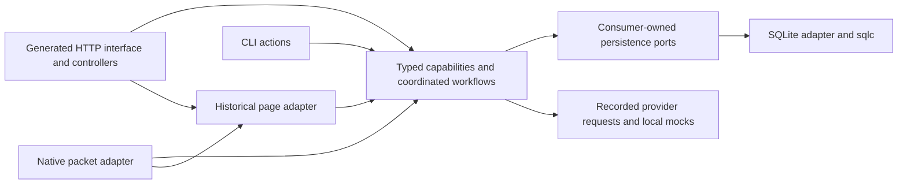

# Ports, adapters and one complete capability refactor

Research date: 2026-10-29. Status: the selected capability architecture is implemented and verified. Full race/vet, generator/schema checks and all 17 original-client suites pass. The [backend architecture](../../docs/backend.md#composition-routing-and-persistence) documents the actual package graph. The [implementation record](evidence/go-capability-implementation.json) retains final checks and 48 client scenarios; the [migration inventory](evidence/capability-test-migration.json) maps all 179 original test names.

This was implemented as one coordinated refactor with internal checkpoints. Capability services, typed commands/events, consumer-owned contracts and native/legacy-web adapters replace the all-purpose `services.Application`. The former service and domain-alias packages and broad ports have been removed. One realtime coordinator retains the necessary shared-state workflows without owning templates, packet layouts or concrete persistence.

The options and baseline observations below remain the research rationale. The original source-audit JSON files and hashes are unchanged; references to old paths are historical evidence, while code links now point to their current owners. Fowler's small behavior-preserving transformations describe the internal method, not a requirement for several user-facing releases. [Refactoring](https://refactoring.com/), [Branch by Abstraction](https://martinfowler.com/bliki/BranchByAbstraction.html). The [retired source snapshot](evidence/capability-before-source.tar.gz) retains the exact deleted packages and tests; its SHA-256 is `7ce316122bdbe1de35e5e74ee2b9a10f67f92c7241dba1590b863228fafe6a5b`.

## Where ports and adapters help here

The pattern separates application behavior from the technologies that drive it or fulfill its requests. It does not prescribe a folder count or require an interface for every function. [Cockburn's original article](https://alistair.cockburn.us/hexagonal-architecture).

The audited backend already had HTTP/socket adapters and SQLite/sqlc repository ports. This refactor completed the internal boundaries:

| Boundary | Audited baseline | Implemented owner |
| --- | --- | --- |
| Typed operations | `internal/services/transcripts.go` constructed native message packets from JSON. | [Realtime transcripts](../../internal/realtime/transcripts.go) call shared typed behavior; [native codecs](../../internal/adapters/nativecodec/codec.go) translate the original frames. |
| Historical pages | `internal/services/page_routes.go` mixed selectors, policy and rendering. | [Legacy page registry](../../internal/adapters/legacyweb/page_routes.go) and consumer-owned workflow contracts serve HTTP and native pages. |
| Persistence | One application consumed the combined 124-operation interface. | Capability-owned `Repository` contracts are implemented by one [SQLite adapter](../../internal/adapters/sqlite/repositories/ports.go), preserving atomic workflows. |
| Realtime | `internal/services/application.go` held account policy, rendered packets, sessions and gates. | [Coordinator](../../internal/realtime/application.go) owns live state and typed events; [delivery handles](../../internal/events/event.go) identify reservations. |
| Providers | SMS/email/payment requests were mocked and IM disconnected. | [Activity service](../../internal/activity/service.go) and capability operations retain those local recorded behaviors; no real provider or generic event bus was introduced. |

The audited object had 182 methods across 41 production files. Its code imported protocol types in 24 files and page rendering in 19. These are source-audit observations, not a claim that the project has 182 independent services. See the [prior AST audit](go-domain-boundaries-audit.json) and [boundary review](evidence/hexagonal-fit.json).

The following diagram summarizes implemented runtime calls, not Go import arrows:

Go interfaces should generally belong with their consumers and express demonstrated needs. A public concrete method can serve as an application port; a duplicate interface beside every service is unnecessary. Controllers can declare the small behavior contracts they consume, and capability packages can declare their outbound repository contracts. [Go interface guidance](https://go.dev/wiki/CodeReviewComments#interfaces).

## Ownership and dependency rules

Keep `cmd/internal/command` for command policy, `cmd/internal/wiring` for concrete assembly, and `internal/bootstrap` for generic lifecycle supervision. All four entrypoints choose their transports; `omni` supplies both with the same realtime owner. The existing command-private visibility is already verified in [the command boundary evidence](evidence/command-package-boundary.json).

Use capability packages for accounts, contacts, chat, rooms, community, commerce, catalog, media, and review/support. Split activity/inbox and recorded provider requests by their actual operations rather than recreating the mixed `ServicesRepository` under a new domain name. The [ownership plan](evidence/single-delivery-plan.json) maps existing files to 15 architecture responsibilities; mixed files require declaration-level extraction.

Each capability owns its types, decisions, typed use cases and required ports. Start with cohesive packages containing files such as `service.go`, `types.go`, and `repository.go`. Additional subpackages need a real visibility or dependency purpose. Private conversations, roster groups, public rooms and community Groups retain distinct models.

Keep controllers in one package implementing the generated OpenAPI interface, with files divided by feature. Replace its single broad service dependency with explicitly typed collaborators. Shared IDs/errors can remain in a small common vocabulary; generated HTTP DTOs, sqlc records, packets, URLs/forms and rendered page responses belong at their respective boundaries. Do not move every current domain type into an undifferentiated `common` package.

Typed capability/workflow entrypoints must preserve trusted actor/session resolution and authorization across HTTP, native and CLI. Adapters cannot substitute an arbitrary caller-supplied username for authenticated identity. Transport-specific validation and error ordering must also survive the DTO split.

Constructors take explicit collaborators and do no I/O. Pass `context.Context` first to operations that need cancellation or I/O, retaining the already implemented caller-context and shutdown rules. Do not store request contexts or dependencies in context values. Pure policy helpers need neither a context nor an interface. Keep `*slog.Logger` concrete; use a function dependency for time/IDs only where an actual test or behavior requires substitution.

Business packages must not import concrete SQL/sqlc, generated HTTP, native protocol, templ/pages, runtime configuration or bootstrap. Adapters may import capability contracts and pure policies. Wiring imports the concrete implementations. Architecture checks should enforce these directions.

## Transactions are part of the contracts

Package boundaries must preserve existing atomic workflows:

- Registration creates the account, initial roster and Friends group together.
- Message acceptance coordinates relevant durable authorization checks, the message, audience and idempotency record.
- Gift purchase coordinates balance/ledger, inventory, note and durable message creation.

| Choice | Application here |
| --- | --- |
| **Specialized atomic workflow port** | Recommended final design for these workflows. An operation such as `PurchaseGift(ctx, command)` promises a committed result or failure. Its SQLite implementation coordinates the required generated queries. |
| Explicit transaction-scoped repository callback | An alternative when application orchestration genuinely needs several named repositories in one transaction. More scope/lifetime rules; introduce for a concrete use case. |
| Independent commits followed by an in-memory event | Cannot replace these atomic contracts: failure between the commits leaves inconsistent state. |
| Durable outbox | Appropriate for future asynchronous external effects. Existing message/audience records already retain delivery intent; a generic event framework is not needed for this structural change. |

Keep pure calculations and decisions in capability policy code. Checks depending on mutable permissions, membership or balance must remain coordinated with the mutation, using transactional reads/rechecks. Moving a permission check outside the transaction merely to make a diagram cleaner would introduce a race.

The adapter should continue using `BeginTx(ctx, nil)` and transaction-bound sqlc queries. SQL transaction objects stay inside the adapter. Go warns against mixing transaction operations with unrelated database calls; sqlc supplies `WithTx` for binding queries. [Go transactions](https://go.dev/doc/database/execute-transactions), [sqlc 1.31.1 transactions](https://docs.sqlc.dev/en/v1.31.1/howto/transactions.html).

An explicit callback transaction runner is not automatically the full object-change-tracking Unit of Work pattern. If asynchronous integration is later added, durable intent, retry, duplicate handling and ordering need their own contracts. [Unit of Work](https://martinfowler.com/eaaCatalog/unitOfWork.html), [Transactional outbox](https://docs.aws.amazon.com/prescriptive-guidance/latest/cloud-design-patterns/transactional-outbox.html). The [transaction review](evidence/transaction-module-options.json) retains the alternatives and current invariants.

## Realtime state needs one deliberate owner

The highest-risk extraction is shared state, not directory movement. Preserve the existing relative order of response gates, account delivery gates and the shared state mutex wherever those locks are acquired together. Capabilities must not create separately locked copies of sessions, participants or ballots.

A focused realtime application coordinator owns session lifecycle, presence, live participation, ballot scheduling, delivery reservations and response/write ordering. It calls capability services synchronously and applies their committed results to caches and sessions before releasing the relevant workflow boundary. Capabilities must not call back into that coordinator while holding locks. Room/vote rules remain in the rooms capability; scheduling and live state have the single realtime owner.

Examples include password changes followed by session invalidation, blocking followed by queued-delivery cancellation, and joining/kicking followed by participant and recipient updates. These coordinated operations are legitimate permanent application behavior. They must not become an excuse to move all 182 methods unchanged into a package named `realtime`.

The baseline correlated delivery using `*protocol.Packet` identities. The implementation now uses typed events and stable per-reservation `events.Handle` values for write completion, cancellation and retry. Encoded-packet associations remain only in the native adapter. Bounded `Poll(ctx, sessionID, limit)` replaces exposing a mutable push queue to transports. A message ID alone is insufficient across sessions, own-message copies and repeat attempts. Preserve eligibility rechecks and existing delivery semantics; do not claim exactly-once delivery.

Also preserve canonical message hashing. Persisted idempotency hashes include JSON serialization of `chat.MessageInput`, so changing field order while moving types can change replay behavior even when field names are identical.

## One delivery, dependency-ordered checkpoints

These are implementation checkpoints within the authorized change, not separate approval or release phases:

1. **Map contracts and behavior.** Assign every existing application operation to its final owner. Record state, lock, transaction, cancellation, URL, packet and rendering invariants. Preserve the interactive demo and use isolated fixtures.
2. **Establish owned types and ports.** Define typed commands/results and narrowly scoped collaborators, then adapt SQLite mappings without changing persisted contracts.
3. **Extract capability logic.** Separate decisions from parsing/rendering; retain cross-capability atomic operations. Run relevant existing tests at each boundary.
4. **Establish realtime ownership.** Introduce typed delivery events/handles and explicit workflows for session, block, room and credential transitions. Verify interleaving and cancellation behavior before moving more callers.
5. **Complete all transport adapters.** Move native dispatch/encoding and historical page handling outside business packages. Both native and modern APIs invoke shared typed behavior.
6. **Wire every entrypoint and remove migration code.** Keep bootstrap generic, share the graph in `omni`, and make CLI actions use typed operations without listeners. Remove the all-purpose application, obsolete aggregate dependencies and temporary bridges.
7. **Verify and document the complete result.** Run full race tests and vet, schema/reference checks, architecture guards, API/protocol/rendering checks, and all 17 existing native-client scenario runners on isolated final builds. Record source/binary/JAR hashes and acceptance evidence.

Parallel work begins after contracts and ownership are settled. Capability extraction and adapter work can then proceed in assigned files. Shared state, cross-capability workflow contracts, wiring and registries need a single integrating owner. This saves time without letting several contributors independently redesign the same session object.

## Completion criteria and current status

- Every current capability has a typed API and explicit collaborators; there is no renamed all-feature application or retained old business implementation.
- Business packages exclude transport/rendering/database implementation types and do not receive the 124-operation repository aggregate.
- Every existing caller uses the final implementation, including HTTP, socket, native pages and CLI. Historical routes, packet fields/errors, template behavior, catalog assets and schema remain compatible.
- Typed entrypoints retain trusted identity resolution, authorization and transport-specific validation; moving an operation never creates a route around those checks.
- Shared sessions, lock ordering, atomic writes, canceled reservations, offline delivery, own-session copies and idempotency replay retain their behavior.
- All four commands build; lifecycle ownership, request contexts, readiness and bounded cleanup remain correct.
- Full verification passes, including all 17 inventoried scenario scripts plus their shared runner. Pre-existing fixture problems are diagnosed and recorded rather than silently skipping coverage.

The implementation remains one Go module and one database. Database replacement, distributed state, additional features, real providers and Expo/v3 presentation are outside this architecture change. Narrow ports make adapter substitution possible, but any new database implementation will still need migrations, query implementations and semantic conformance tests.

The [source catalog](go-hexagonal-migration-sources.json), [boundary review](evidence/hexagonal-fit.json), [transaction review](evidence/transaction-module-options.json), and [complete ownership/checkpoint plan](evidence/single-delivery-plan.json) retain the research. Their source paths refer to the pre-refactor snapshot; hashes distinguish that evidence from a later implementation. [Research validation](evidence/hexagonal-research-validation.json) checks the retained evidence, links, scenario inventory and unchanged production snapshot. That research-validation record describes the research-only snapshot. Completed implementation checks, original-client acceptance, regression fixes and isolated harness corrections are recorded separately in [go-capability-implementation.json](evidence/go-capability-implementation.json).
